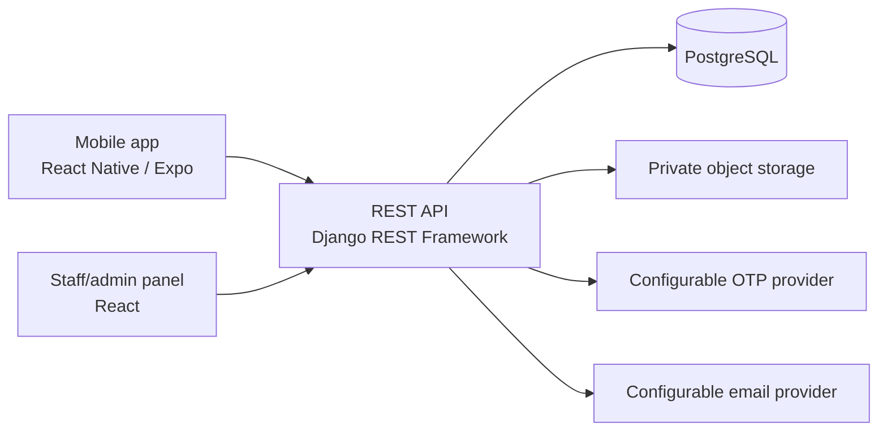

# SmartTrade architecture

## Scope and labels

This architecture covers Release 1: account/authentication foundations; manual business and company verification; brand and company-owned product catalogues; dealer locations and location-specific listings; authenticated dealer discovery; and the staff/admin panel. Quotations, invoices, service providers, job seekers, employers, and later commercial features are deferred.

- **Confirmed** means finalized by the project owner or explicitly included in the requirements.
- **Recommendation** means a proposed implementation policy that still needs approval where stated.
- **Open** means the requirements do not define the behavior.

See [decisions.md](decisions.md) for the decision register and [database-design.md](database-design.md) for constraints and the ER diagram.

## System shape

**Recommendation:** Expo/React Native mobile app, React admin panel, Django REST Framework API, PostgreSQL, and private object storage. Both clients use the same versioned API. The API is authoritative for account status, access control, ownership, verification, catalogue publication, dealer listings, and file access. Do not rely on frontend checks for permissions.

Provider configuration and credentials are external to source code. Cloud, OTP, email, and object-storage vendors remain configurable choices.

## Client surfaces and navigation

**Recommendation:** Keep a shared authenticated mobile shell with role-aware sections; one account has one account type, so another role requires a separate account.

- **Personal:** catalogue/category search, product detail, company catalogue information, authenticated dealer search/results, and dealer/location details/contact.
- **Business:** registration and verification state, business profile and private draft locations, location-specific listing/stock/price management after verification.
- **Company:** company registration/email verification and state, owned brand/product catalogue, catalogue assets/prices, representatives, and company + brand + dealer authorization grants.
- **Shared account:** OTP sign-in, profile completion, verification documents/state, and account/session controls.
- **Staff web panel:** staff sign-in; user lookup; business/company verification queues; taxonomy and brand-suggestion management; catalogue/product moderation and duplicate review; dealer businesses, locations, listings, representatives/grants; audit history and reports.

These are suggested screen groups, not a finalized visual navigation design. Quotations/invoices, jobs, service providers, and employer screens are omitted from Release 1.

## Account and authorization model

**Confirmed:** one account per normalized mobile number; exactly one account type; using another account type requires a separate account/mobile. Staff/admin is a distinct account type and is not a profile flag on an ordinary account.

**Recommendation:** A shared `Account` identity row has a normalized E.164 mobile number with a database `UNIQUE NOT NULL` constraint and one immutable `account_type`: `PERSONAL`, `BUSINESS`, `COMPANY`, or `STAFF`. One-to-one `PersonalProfile`, `BusinessProfile`, `CompanyUserProfile`, and `StaffProfile` tables hold the matching account subtype. `CompanyProfile` is the organization; company-type accounts join it through a `CompanyRepresentative` membership. Each company account may belong to only one company, including after membership revocation; a company may have multiple separately authenticated representatives. A deferred database constraint trigger (or equivalent database-enforced invariant) ensures exactly one matching account subtype exists and no nonmatching subtype exists. Staff role assignments are separate records. This preserves global mobile uniqueness across staff and marketplace accounts while isolating staff authority. See database design for the enforcement approach.

Ordinary account creation accepts a permitted marketplace account type only. The API ignores/rejects client-supplied account type changes, staff role assignments, verification states, ownership IDs, and audit actors. Staff accounts are provisioned only by an authorized staff workflow; ordinary users cannot promote themselves. Account type is immutable after creation.

### Permission matrix

| Account/status | Permitted actions | Prohibited actions |
|---|---|---|
| Personal, active | Browse catalogue; authenticated dealer search/details; manage own personal profile | Manage dealer listings, company catalogue, verification, or staff permissions |
| Business, pending | Sign in; complete own business profile; upload/read own business verification documents; view own review state | Publish/show as verified dealer; create public product listings; access other users' private files |
| Business, verified | Pending actions plus manage own dealer locations and location-specific listings, availability, stock, and selling prices | Change company catalogue data, self-verify, grant company authorization |
| Company, pending before submission | Sign in; complete own company profile; upload/read own verification documents; view own review state | Create canonical brands or publish catalogue products; grant dealer authorization |
| Company, verified and activity `ACTIVE` | Manage owned brands/catalogues/products; publish products immediately; appoint authorized company representatives; grant/revoke own brand-to-dealer authorizations | Change business verification or another company's catalogue/authorizations |
| Company activity `SUSPENDED`, account not otherwise blocked | Sign in; view company suspension status; submit restricted company review request; use other permitted account-level functions | Publish or perform other company-scoped writes; expose company catalogue |
| Any account independently `BLOCKED` | Only explicitly authorized recovery/review-request functions | Normal protected features, regardless of separate company verification or activity state |
| Staff, active | Only actions assigned by staff role/permission; all sensitive actions audited | Marketplace role actions unless separately represented as an ordinary account (which uses a distinct account/mobile) |
| Staff, disabled | No staff access | All staff operations |

All authenticated accounts must be active. **Confirmed:** catalogue browsing is public, while dealer discovery and dealer details require login. Public responses include only eligible products/assets and never private company or verification data.

### Account and verification states

Account access state, business verification, company verification, product moderation, and dealer authorization are independent concepts:

- Business/company verification: `PENDING`, `VERIFIED`, `REJECTED`. Company activity suspension is not a verification outcome.
- Company activity/suspension: separate `ACTIVE` or `SUSPENDED` state. Suspension suppresses all catalogue visibility and company write/grant activity while preserving verification state, products, dealer mappings, memberships, and audit history. It does not block company-associated accounts from sign-in or otherwise permitted account-level functions.
- Account access: `ACTIVE` or `BLOCKED`; company verification rejection and company activity suspension do not automatically change the linked account state. An independently blocked account remains restricted to explicitly authorized recovery/review-request functions until admin restoration.
- Staff access: `ACTIVE` or `DISABLED`, independent of marketplace verification.
- Product moderation: `PUBLISHED`, `HIDDEN`, or `SUSPENDED`; company catalogue status (for example discontinued) is a separate field.
- Authorized dealer: an explicit active/revoked company + brand + business relationship; never inferred from business verification.

**Visibility recommendation:** A product is discoverable only while its owning company is currently verified and activity `ACTIVE`, the product moderation state is `PUBLISHED`, and its public assets are approved. A dealer result additionally requires a currently verified business, visible location, and eligible listing. If company verification is rejected or company activity is suspended, its products and related authorization labels are suppressed from discovery; product moderation state and grant history remain unchanged.

**Confirmed recovery policy:** Rejected or suspended accounts remain blocked from normal protected actions until an administrator restores them. Blocking revokes the account's active sessions and refresh tokens. Restoration is audited and does not revive old tokens; the user must authenticate again. A restricted recovery request may accept a request after recovery-only identity verification, but cannot grant marketplace access, change verification state, or restore access. Company activity suspension alone does not revoke sessions; each request is authorized against current account and company states, so suspended company writes remain denied while permitted account-level reads and review requests work.

Each company-type account may belong to at most one company, enforced by a unique account-to-company relationship. A company may have separately authenticated owner/representative accounts. Each company has one owner; membership and permissions are retained as history when revoked. Company activity suspension suppresses its catalogue and disables new company-scoped activity without deleting records or audit history; it does not change linked account access.

The initial implementation stores one immutable company owner account (`COMPANY`) per `CompanyProfile`; additional representative membership/permissions remain future work. Verification review and activity suspend/restore are separate staff actions. Rejection disables catalogue eligibility but does not itself block the owner account. Company email verification and private document upload fail closed until real providers and explicit file policy configuration are supplied.

## Catalogue, brands, and dealer inventory

Each canonical `Brand` belongs to exactly one verified `CompanyProfile`; one verified company can own multiple brands. A pending company may submit brand details in its application, but canonical brand creation is unavailable until verification. Company owns product and variant data, catalogue/list price, description, specifications, product assets, and catalogue change history.

Dealer businesses may have multiple `DealerLocation` rows. Each listing belongs to exactly one location and one company-owned product, with an optional variant; stock, availability, and selling price are maintained independently per location. Catalogue price is never overwritten by dealer selling price. The unique listing key is location + product + variant, with a separate uniqueness rule for no-variant listings.

An authorized-dealer grant is scoped to company + brand + dealer business. It does not imply product ownership, business verification, or permission to edit the catalogue. Only active authorized representatives of the owning company with `MANAGE_AUTHORIZED_DEALERS` can grant or revoke it. The company owner has all representative permissions and may assign narrower rights. Representative changes are audited.

Pending businesses may create location drafts while completing their profiles. Draft locations are visible only to the business owner and assigned reviewer. Once verified, the owner may explicitly make each location visible; verification alone does not publish a location.

## Dealer discovery

Dealer search requires login and matches PIN code first, then locality/area and district. Results reference a specific `DealerLocation`; its location-specific availability and selling price are returned separately from catalogue price. Results show business verification and authorized-dealer status as separate fields. Only verified businesses with eligible active listings appear as verified dealers. If no direct location match is available, an optional GPS nearby fallback must be clearly labelled as a nearby result; GPS permission and a search radius are not assumed.

GPS is optional and only used for nearby-distance features. Exact/partial matching, sort order, nearby radius, and no-result behavior remain open in [decisions.md](decisions.md).

## Staff permissions and audit history

**Confirmed:** Staff/admin identities are separate from marketplace accounts and use least-privilege permissions. Provision the initial super-admin through a secure, controlled bootstrap that does not expose public staff registration; the operational bootstrap mechanism must be approved before implementation. Assign staff roles through database-backed `StaffRole`, `StaffPermission`, and `StaffRoleAssignment` relations; permissions are checked by the API, not frontend route visibility.

| Staff role | Proposed permissions |
|---|---|
| `PLATFORM_ADMIN` | `MANAGE_STAFF`, manage taxonomy, review business/company verification, handle review requests, suspend/restore companies, moderate products, read audit and reports. |
| `VERIFICATION_REVIEWER` | `REVIEW_BUSINESS`, `REVIEW_COMPANY`, `HANDLE_REVIEW_REQUESTS`, and assigned-case `VIEW_PRIVATE_DOCUMENTS`; cannot grant dealer authorization or change catalogue data. |
| `CATALOGUE_MODERATOR` | `MANAGE_TAXONOMY`, `REVIEW_DUPLICATES`, `MODERATE_PRODUCTS`; cannot decide business/company verification. |
| `AUDIT_READER` | `READ_AUDIT` only; cannot change marketplace records. |

Reports require `READ_REPORTS`; platform admins receive it by default. The first super-admin is created through a secure, controlled bootstrap outside ordinary signup; exact operator/procedure and credential handoff are documented before deployment. No public registration or self-promotion route exists.

The role names and bundle mapping are implementation recommendations; any action not explicitly granted remains denied. Additional separation-of-duty rules remain an operational decision.

Company representative permissions are `MANAGE_COMPANY_PROFILE`, `MANAGE_CATALOGUE`, and `MANAGE_AUTHORIZED_DEALERS`. The owner account has all three and is also stored as an active representative row, so grant actors always reference a real representative. Additional representatives receive only explicitly assigned permissions. Only the owner may appoint/revoke representatives in the proposed policy; delegation of that management power is unresolved.

Record append-only audit events for registration/profile state changes, verification decisions, review requests, staff permission changes, brand/product updates, company suspension/restoration, product hide/suspend/restore, dealer location/listing/price/stock changes, file upload/download/replace/delete, trade-worker contact submissions, and authorization grant/revocation. Each event has an account FK actor, exactly one explicit FK subject, action, timestamp, and relevant reason/change details. No ordinary API may update/delete audit rows. Retention duration and legally required archival/purge policy remain to be confirmed; retain records until an approved policy is established.

## File security

Use private object storage. Relational document/asset rows have explicit foreign keys to their business, company, verification case, or product; do not use a polymorphic `owner_type/owner_id`. The API authorizes every upload and download. File size/type limits must be configurable. Maintain a documented retention schedule and access policy; specific limits, retention periods, and temporary-link lifetimes remain unset until approved. Verification documents and other private files are never publicly accessible.

| File category | Upload/replace | View/download | Delete |
|---|---|---|---|
| Business verification document | Owning pending/verified business account; replacement creates a new version | Owner and assigned staff reviewer | Owner cannot erase submitted evidence; staff may mark superseded/withdrawn with reason. Physical deletion follows retention policy only. |
| Company verification document | Owning pending/verified company account; replacement creates a new version | Owner and assigned staff reviewer | Same controlled supersede/withdrawal rule as business evidence. |
| Company logo/profile asset | Owning pending/verified company account; verified company representative with `MANAGE_COMPANY_PROFILE` | Pending assets only to owner/reviewer; public only after company verification and asset approval | Deactivate/replace with history; no public access before approval or after deactivation. |
| Product image/catalogue asset | Verified owning company or representative with `MANAGE_CATALOGUE` | Owning company and authorized staff; public readers only for approved assets on published products | Soft-deactivate with audit; physical object retention follows policy. |

Sensitive files are never exposed through public API responses. Return neither storage keys nor permanent sensitive-document URLs. Any temporary download authorization is short-lived and issued only after access checks. File upload, access, replacement, and deactivation are audited.

## Security boundaries

- Business and company registration review is manual by staff.
- Verified companies can publish immediately; staff can hide, suspend, or restore products without changing company verification.
- Dealer listings require verified business ownership and must reference products/variants consistently.
- Company/brand/business relationships and representative authority are checked on the server and protected by foreign keys.
- OTP, email, cloud, and object-storage credentials are configurable secrets, not source code.
- Rate limits, OTP recovery, file limit values, retention periods, consent wording, and nearby search radius remain configuration requirements or open operational specifications in `decisions.md`. Registration-fee collection is disabled in Release 1; future fees, if approved, must be configurable and are out of scope now.

Trade-worker contacts are not public profiles. A business must confirm it has permission before submitting contacts, and each contact must separately opt in before a later service-provider profile can be created. Release 1 stores contacts privately for registration only and never creates service-provider profiles automatically.
