# SmartTrade database design

This is the PostgreSQL relational model for Release 1. The account/authentication foundation and initial company registration/verification workflow are implemented in `services/api/accounts/` and `services/api/companies/`; migrations `accounts/0001_initial.py` and `companies/0001_initial.py` create their current schemas. Catalogue, listing, representative, and dealer-authorization entities remain design-only. PostgreSQL-specific company ownership, case/document consistency, append-only audit, and account subtype guards have not been run against a PostgreSQL server.

## Core entities and foreign keys

| Table | Important columns and relationships |
|---|---|
| `Account` | `id` PK; `mobile_e164` canonical E.164 `NOT NULL UNIQUE`; immutable `account_type` enum `PERSONAL/BUSINESS/COMPANY/STAFF`; `access_state` enum `ACTIVE/BLOCKED`; `mobile_verified_at`; `token_version`; Django password field is unusable for mobile OTP accounts. Blocking/logout increments token version; raw JWTs and OTP codes are not persisted. |
| `PersonalProfile` | `account_id` PK/FK to `Account`; full name, occupation, PIN/area/district/state, and optional location. Exists only for `PERSONAL`. |
| `BusinessProfile` | `id` PK; `account_id` `UNIQUE NOT NULL` FK to `Account`; business name, owner/authorized person, GST/license, email, address, independent verification state. Exists only for `BUSINESS`. |
| `BusinessTradeWorkerContactSubmission` | FK to `BusinessProfile` and submitting `BUSINESS` account; non-null `permission_confirmed_at` and confirmation actor. One row represents a submission batch, so the business confirms permission for each submitted batch. |
| `BusinessTradeWorkerContact` | FK to `BusinessProfile` and `BusinessTradeWorkerContactSubmission`; name, contact mobile, trade/profession, optional area/location, separate opt-in state/time and consent evidence. Source requirements call for at least ten contacts during business registration; no service-provider profile is created in Release 1. |
| `CompanyUserProfile` | `account_id` PK/FK to `Account`; company-user identity/contact data. Exists for every `COMPANY` account, including representatives. |
| `CompanyProfile` | Implemented: `id` PK; unique `owner_account_id` FK to a `COMPANY` `Account`; legal/trading names, registration/tax identifiers, authorized person, company email and `email_verified_at`, address fields, website, `verification_state` (`PENDING/VERIFIED/REJECTED`) and independent `activity_state` (`ACTIVE/SUSPENDED`). PostgreSQL trigger and model validation require a COMPANY owner; catalogue eligibility requires VERIFIED + ACTIVE + active owner account. Representatives remain planned. |
| `StaffProfile` | `account_id` PK/FK; `ACTIVE/DISABLED` state; exists only for `STAFF`. The controlled bootstrap command creates this profile and does not mark its mobile verified. |
| `StaffRole`, `StaffPermission`, `StaffRolePermission`, `StaffRoleAssignment` | Staff-only RBAC. Assignment references a `STAFF` account; role grants explicit permissions including `MANAGE_STAFF`, `REVIEW_BUSINESS`, `REVIEW_COMPANY`, `HANDLE_REVIEW_REQUESTS`, `VIEW_PRIVATE_DOCUMENTS`, `MANAGE_TAXONOMY`, `MODERATE_PRODUCTS`, `SUSPEND_COMPANY`, `RESTORE_COMPANY`, `READ_AUDIT`, and `READ_REPORTS`. Normal assignment actor is a staff account; the initial controlled bootstrap uses `grant_source=BOOTSTRAP` with no staff actor because no staff identity exists yet. |
| `BusinessVerificationCase` | FK to `BusinessProfile`; status/decision, nullable reviewer FK to `StaffProfile` until decided, reason, submitted/reviewed timestamps. New cases preserve review history. |
| `CompanyVerificationCase` | Implemented: FK to `CompanyProfile`, owner submitter FK, status (`PENDING/APPROVED/REJECTED`), optional assigned and deciding `StaffProfile` FKs, submitted/reviewed timestamps, and decision reason. One pending case per company; a PostgreSQL guard requires the owner submitter and a staff reviewer/reason for a decision. Only the assigned reviewer may decide/read private case documents. Resubmission after rejection is not currently available; reopen policy remains open. |
| `Category` | Admin-managed category, active state, optional self-FK parent. |
| `Brand` | `company_id` FK to verified `CompanyProfile`; brand belongs to exactly one company. `UNIQUE(id, company_id)` supports composite consistency constraints. |
| `BrandCategory` | FKs to `Brand` and `Category`; composite PK/unique `(brand_id, category_id)`. |
| `BusinessCategory` | FKs to `BusinessProfile` and `Category`; unique pair. |
| `BusinessBrand` | FKs to `BusinessProfile` and `Brand`; unique pair and optional review state. |
| `BrandSuggestion` | Business FK, category FK, submitter business account FK, proposed name, admin reviewer FK, decision, and nullable `accepted_brand_id` FK. Not a canonical brand until accepted. |
| `CompanyRepresentative` | PK `id`; `company_id` FK to `CompanyProfile` and `account_id` FK to `Account`; membership role `OWNER` or `REPRESENTATIVE`; unique `account_id` across all memberships, including revoked history. Each account can link to only one company. Account must be type `COMPANY`. |
| `CompanyRepresentativePermission` | FK to `CompanyRepresentative`; permission enum `MANAGE_COMPANY_PROFILE`, `MANAGE_CATALOGUE`, or `MANAGE_AUTHORIZED_DEALERS`; composite PK `(representative_id, permission)`. Owner row has all permissions. |
| `Product` | FK to `Brand` and `Category`; product name/code/model description/specs/unit, catalogue price, HSN/GST, company status and moderation status. Owner is derived from its brand. |
| `ProductVariant` | FK to `Product`; model/code/variant fields. `UNIQUE(id, product_id)` supports listing composite FK. |
| `ProductVersion` | FK to `Product`; immutable catalogue snapshot/version number, catalogue price and changed fields, actor account FK, timestamp. Unique `(product_id, version_number)`. |
| `DealerLocation` | FK to `BusinessProfile`; location name/contact and PIN code/area/district/state, optional coordinates, active state. Multiple rows per business are allowed. Address fields are stored with this location, not through a polymorphic address owner. |
| `DealerProductListing` | FK to `DealerLocation`, `Product`, optional `ProductVariant`; location-specific selling price, stock, availability, and active state. Product is company-owned; listing is dealer/location-owned. |
| `AuthorizedDealerGrant` | FK to `CompanyProfile`, its brand, and dealer `BusinessProfile`; active/revoked state; grant/revoke actor FKs to `CompanyRepresentative`; timestamps and reason. Scope is company + brand + business. |
| `BusinessDocument` | FK to business profile, business verification case, uploader account; private object key and file metadata. No public URL. |
| `CompanyDocument` | Implemented: FK to company profile, optional verification case, uploader account, private `FileField`, configured document type, original filename, MIME type, byte size, and timestamp. Storage root is private and not routed publicly; API responses expose no storage key or URL. PostgreSQL trigger requires uploader ownership and matching company/case. |
| `CompanyAuditEvent` | Implemented company-scoped audit subject FK, actor `Account` FK, optional verification-case FK, action, timestamp, reason, and structured details. Application model and PostgreSQL trigger prohibit update/delete. |
| `CompanyReviewRequest` | Implemented restricted request tied to company and submitting owner account, reason, state, submission time, optional staff resolver, resolution time/reason. Handling the request does not restore company activity or account access. |
| `CompanyAsset` | FK to company profile and uploader account; logo/profile asset storage metadata, visibility/approval state, version/deactivation timestamps. |
| `ProductAsset` | FK to product and uploader account; object key, type, checksum, size, publication/approval state. |
| `AuditEvent` | Actor FK to `Account`; exactly one explicit subject FK from supported subject columns (account, business, company, staff, verification case, category, brand, brand suggestion, company representative, trade-worker contact/submission, review request, product, product version, variant, location, listing, authorization grant, business/company document, company asset, or product asset); action, timestamp, reason/change details. |
| `ReviewRequest` | FK to requesting `Account`; nullable FKs to `BusinessVerificationCase`, `CompanyVerificationCase`, and `CompanyProfile`, with a check requiring exactly one target. Supports recovery review for blocked accounts and restricted company-activity review requests. Includes status, message, timestamps, and handling staff FK. Blocked-account requests use recovery-only identity verification, not a marketplace session. A request never restores access or changes verification/activity state. |
| `CompanyRegistrationFeeConfiguration` (future only) | Optional future configurable fee/currency/effective settings. No fee collection, payment flow, or fee-enforcement row is active in Release 1. |

Company owners and representatives are `COMPANY` accounts with a `CompanyUserProfile`. Each account has at most one company membership for its lifetime; a revoked account cannot be attached to a different company. Each company has exactly one owner membership and may have multiple separately authenticated representative accounts. The owner membership has all permission rows; additional representative permissions are explicit.

## Constraints and indexes

### Accounts

1. Store phone numbers in a single normalized format, proposed E.164, and enforce `UNIQUE NOT NULL` on `Account.mobile_e164`. Normalize/validate before insertion. This unique constraint covers personal, business, company, and staff accounts because all share `Account`.
2. `account_type` is one enum value, not a many-to-many role list. It cannot be supplied/changed by ordinary clients.
3. Account subtype tables have `account_id` as PK/FK (or a unique FK for `BusinessProfile`). A deferred constraint trigger validates at transaction commit that exactly one matching subtype exists: PERSONAL/PersonalProfile, BUSINESS/BusinessProfile, COMPANY/CompanyUserProfile, STAFF/StaffProfile. `CompanyProfile` is a separate organization owned by a company-type account and is not the COMPANY subtype row. This cross-table subtype rule cannot be expressed as a plain `CHECK` constraint.
4. Account type changes are prohibited. A different marketplace role requires a separate account and globally unique mobile number. Staff provisioning is separate and privileged. A company-type account can reference at most one company for its lifetime.
5. Company verification state, company activity state, account access state, and authorized-dealer status are separate. Company verification rejection prevents catalogue eligibility but does not itself block the owner account. Company activity suspension does not change account access state or revoke tokens; backend authorization checks current company activity state and denies company-scoped writes. Only a separate authorized account-block action changes `Account.access_state` and invalidates tokens. Restoring company activity never clears an independent account block.

### Company, brand, product ownership

- `Brand.company_id` is a non-null FK to one `CompanyProfile` and identifies exactly one owner. A company may own many brands. A transaction/trigger validates verified company state at brand creation; cross-table verification state is not a basic FK constraint.
- `Product.brand_id` is required. Company ownership derives through brand, preventing client-selected product owner. Product edits require a verified owner company and are audited.
- `Product(brand_id, category_id)` references `BrandCategory(brand_id, category_id)` so a product cannot claim a category not associated with its brand. This uses a composite FK and a unique key on the junction pair.
- `ProductVariant(id, product_id)` unique pair plus listing composite FK `(variant_id, product_id)` ensures any selected variant belongs to that product. When no variant applies, `variant_id IS NULL` and the listing references the product directly.
- Index product search by category, brand, normalized product name, code, model, and moderation/publication status. Do not impose global product-code uniqueness without an approved rule; duplicate candidates go to admin review.
- `BrandCategory`, `BusinessCategory`, `BusinessBrand`, and `CompanyRepresentative` have unique composite keys on their relationship pairs. `CompanyRepresentativePermission` has a composite primary key. Revoked representative rows are retained/audited rather than hard-deleted.
- A unique constraint on `CompanyRepresentative.account_id` permits at most one company link per account, including revoked memberships. A partial unique index on active `company_id WHERE membership_role='OWNER'` permits one active owner per company; a deferred constraint trigger requires exactly one owner membership at commit. Membership account must have type `COMPANY` and `CompanyUserProfile`. Owner membership has all representative permission rows.

Company suspension is represented by `CompanyProfile.activity_state`, separately from verification state and `Account.access_state`. An admin suspend/restore transition records actor, timestamp, action, and reason in append-only audit history. Suspension suppresses public catalogue results and denies company-scoped publishing and other company writes while preserving company, product, catalogue, dealer-mapping, membership, and audit rows. It does not block linked accounts or revoke their tokens. Every API request checks current activity state. Independently blocked accounts remain blocked; company restoration does not clear their account block.

```sql
ALTER TABLE company_representative
  ADD CONSTRAINT uq_company_representative_account UNIQUE (account_id);

CREATE UNIQUE INDEX uq_active_company_owner
  ON company_representative (company_id)
  WHERE membership_role = 'OWNER' AND membership_state = 'ACTIVE';
```

### Dealer location visibility

`DealerLocation.visibility_state` is non-null and defaults to `PRIVATE_DRAFT`. A pending business may create/edit its own private draft locations. Only a verified business may set a location to `VISIBLE`; public-to-authenticated search excludes all private or inactive locations. The visibility transition is audited.

### Location-specific listings

One listing exists for each `DealerLocation + Product + Variant` where a variant exists. Since PostgreSQL's ordinary unique constraints treat NULLs as distinct, use two partial unique indexes:

```sql
CREATE UNIQUE INDEX uq_listing_without_variant
  ON dealer_product_listing (dealer_location_id, product_id)
  WHERE variant_id IS NULL;

CREATE UNIQUE INDEX uq_listing_with_variant
  ON dealer_product_listing (dealer_location_id, product_id, variant_id)
  WHERE variant_id IS NOT NULL;
```

This handles products without variants deliberately and does not depend on PostgreSQL 15 `NULLS NOT DISTINCT`. A `DealerLocation` belongs to a single business; each listing uses the location for search and authorization. Index `(product_id, availability_status)`, `(dealer_location_id, availability_status)`, and location search fields (PIN code, district, area). Stock and selling price live only on the listing. Catalogue price lives only on company product/version.

### Authorized dealer mapping

- Unique `(company_id, brand_id, dealer_business_id)` so the current grant for a scope has one row; revoke/reactivate that row while preserving each event in append-only audit history.
- Composite FK `(brand_id, company_id)` references `Brand(id, company_id)` to prevent mapping a brand under the wrong company.
- Granting company must be verified; dealer business must be verified for a grant to become active. The latter is a recommended validation rule. Grant/revoke actor must be an active representative with `MANAGE_AUTHORIZED_DEALERS` for that same company. Cross-row role/status checks occur in the transaction/service layer.
- No dealer location or product scope is part of this confirmed authorization relationship. The authorized status is company + brand + dealer business.

### Verification, documents, and audit

- Verification cases use distinct business/company FKs and staff reviewer FKs; decisions are immutable history rows with `decision`, `reason`, `reviewer_staff_account_id`, `created_at`, and `reviewed_at`. Current state can be cached on the profile but must agree with the latest case.
- A partial unique index permits at most one open/pending verification case per business or company while allowing prior decided cases to remain in history.
- Document rows have explicit owner and verification-case FKs. `ProductAsset` has a product FK. Storage keys are unique and private. Deleting a profile/product should be restricted while records/audit references exist; use soft deactivation/retention instead of cascading away verification or audit history.
- `CompanyAsset` has an explicit company FK; public visibility is a separate approval state. Each file row is linked to one concrete owner. No generic `owner_type/owner_id` is used.
- Business trade-worker contacts are private to the owning business and authorized reviewers in Release 1. Each submission batch records the submitting business account and business permission confirmation; each contact records separate opt-in evidence/state. Do not create public profiles automatically or make contact mobile globally unique because these are contact records, not accounts. Consent wording and contact retention period remain open.
- Each audit event has a real actor FK and one explicit subject FK. A database `CHECK` requires exactly one subject column to be non-null; this avoids a polymorphic `(subject_type, subject_id)` without a foreign key. The tradeoff is a wider audit table and schema updates when adding subject types.
- Audit records are append-only for application/admin roles. No ordinary update/delete endpoint exists. Keep records until an approved retention policy defines archival/deletion obligations; exact duration is unresolved.
- Index all FKs used for ownership/authorization lookups and audit queries (`actor`, subject FKs, timestamps, verification status, location, and listing keys).
- Use `RESTRICT` for deletion of accounts, profiles, products, locations, verification cases, and files referenced by history; deactivate/archive instead. Suspending a company hides its catalogue and disables new activity without deleting catalogue, grant, account, or audit rows. Cascades are limited to disposable junction rows with no independent audit significance. File limits must be configurable; document a retention schedule and access policy without inventing periods. Actual file, audit, and contact retention periods remain open.

## Mermaid ER diagram

```mermaid
erDiagram
    ACCOUNT ||--o| PERSONAL_PROFILE : subtype
    ACCOUNT ||--o| BUSINESS_PROFILE : subtype
    ACCOUNT ||--o| COMPANY_USER_PROFILE : subtype
    ACCOUNT ||--o| STAFF_PROFILE : subtype
    STAFF_PROFILE ||--o{ STAFF_ROLE_ASSIGNMENT : receives
    STAFF_ROLE ||--o{ STAFF_ROLE_ASSIGNMENT : assigned
    STAFF_ROLE ||--o{ STAFF_ROLE_PERMISSION : grants
    STAFF_PERMISSION ||--o{ STAFF_ROLE_PERMISSION : included
    BUSINESS_PROFILE ||--o{ BUSINESS_VERIFICATION_CASE : reviewed
    COMPANY_PROFILE ||--o{ COMPANY_VERIFICATION_CASE : reviewed
    STAFF_PROFILE ||--o{ BUSINESS_VERIFICATION_CASE : reviewer
    STAFF_PROFILE ||--o{ COMPANY_VERIFICATION_CASE : reviewer
    COMPANY_PROFILE ||--o{ BRAND : owns
    BRAND ||--o{ BRAND_CATEGORY : categorized
    CATEGORY ||--o{ BRAND_CATEGORY : classifies
    BUSINESS_PROFILE ||--o{ BUSINESS_CATEGORY : selects
    CATEGORY ||--o{ BUSINESS_CATEGORY : selected
    BUSINESS_PROFILE ||--o{ BUSINESS_BRAND : sells
    BUSINESS_PROFILE ||--o{ BUSINESS_TRADE_WORKER_CONTACT : lists
    BUSINESS_PROFILE ||--o{ BUSINESS_TRADE_WORKER_CONTACT_SUBMISSION : submits
    BUSINESS_TRADE_WORKER_CONTACT_SUBMISSION ||--o{ BUSINESS_TRADE_WORKER_CONTACT : contains
    BUSINESS_VERIFICATION_CASE ||--o{ REVIEW_REQUEST : subject
    COMPANY_VERIFICATION_CASE ||--o{ REVIEW_REQUEST : subject
    STAFF_PROFILE o|--o{ REVIEW_REQUEST : handles
    BRAND ||--o{ BUSINESS_BRAND : listed
    BUSINESS_PROFILE ||--o{ BRAND_SUGGESTION : submits
    CATEGORY ||--o{ BRAND_SUGGESTION : proposed_for
    STAFF_PROFILE ||--o{ BRAND_SUGGESTION : reviews
    BRAND o|--o{ BRAND_SUGGESTION : accepted_as
    COMPANY_PROFILE ||--o{ COMPANY_REPRESENTATIVE : members
    ACCOUNT ||--o| COMPANY_REPRESENTATIVE : membership
    COMPANY_REPRESENTATIVE ||--o{ COMPANY_REPRESENTATIVE_PERMISSION : grants
    BRAND ||--o{ PRODUCT : owns_catalogue
    CATEGORY ||--o{ PRODUCT : classifies
    PRODUCT ||--o{ PRODUCT_VARIANT : has
    PRODUCT ||--o{ PRODUCT_VERSION : versions
    PRODUCT ||--o{ PRODUCT_ASSET : has
    PRODUCT ||--o{ DEALER_PRODUCT_LISTING : listed
    PRODUCT_VARIANT o|--o{ DEALER_PRODUCT_LISTING : optional_variant
    BUSINESS_PROFILE ||--o{ DEALER_LOCATION : has
    DEALER_LOCATION ||--o{ DEALER_PRODUCT_LISTING : location_stock_price
    COMPANY_PROFILE ||--o{ AUTHORIZED_DEALER_GRANT : grants
    BRAND ||--o{ AUTHORIZED_DEALER_GRANT : scope
    BUSINESS_PROFILE ||--o{ AUTHORIZED_DEALER_GRANT : dealer
    COMPANY_REPRESENTATIVE ||--o{ AUTHORIZED_DEALER_GRANT : confirms
    BUSINESS_VERIFICATION_CASE ||--o{ BUSINESS_DOCUMENT : supports
    COMPANY_VERIFICATION_CASE ||--o{ COMPANY_DOCUMENT : supports
    BUSINESS_PROFILE ||--o{ BUSINESS_DOCUMENT : owns_file
    COMPANY_PROFILE ||--o{ COMPANY_DOCUMENT : owns_file
    COMPANY_PROFILE ||--o{ COMPANY_ASSET : owns_file
    PRODUCT ||--o{ PRODUCT_ASSET : owns_file
    ACCOUNT ||--o{ AUDIT_EVENT : actor
    REVIEW_REQUEST o|--o{ AUDIT_EVENT : subject_review_request
    BUSINESS_TRADE_WORKER_CONTACT_SUBMISSION o|--o{ AUDIT_EVENT : subject_contact_submission
    ACCOUNT o|--o{ AUDIT_EVENT : subject_account
    BUSINESS_PROFILE o|--o{ AUDIT_EVENT : subject_business
    COMPANY_PROFILE o|--o{ AUDIT_EVENT : subject_company
    STAFF_PROFILE o|--o{ AUDIT_EVENT : subject_staff
    CATEGORY o|--o{ AUDIT_EVENT : subject_category
    BUSINESS_VERIFICATION_CASE o|--o{ AUDIT_EVENT : subject_business_case
    COMPANY_VERIFICATION_CASE o|--o{ AUDIT_EVENT : subject_company_case
    BRAND o|--o{ AUDIT_EVENT : subject_brand
    BRAND_SUGGESTION o|--o{ AUDIT_EVENT : subject_brand_suggestion
    COMPANY_REPRESENTATIVE o|--o{ AUDIT_EVENT : subject_representative
    BUSINESS_TRADE_WORKER_CONTACT o|--o{ AUDIT_EVENT : subject_trade_contact
    PRODUCT o|--o{ AUDIT_EVENT : subject_product
    PRODUCT_VARIANT o|--o{ AUDIT_EVENT : subject_variant
    DEALER_LOCATION o|--o{ AUDIT_EVENT : subject_location
    DEALER_PRODUCT_LISTING o|--o{ AUDIT_EVENT : subject_listing
    AUTHORIZED_DEALER_GRANT o|--o{ AUDIT_EVENT : subject_grant
    BUSINESS_DOCUMENT o|--o{ AUDIT_EVENT : subject_business_file
    COMPANY_DOCUMENT o|--o{ AUDIT_EVENT : subject_company_file
    PRODUCT_ASSET o|--o{ AUDIT_EVENT : subject_asset
    COMPANY_ASSET o|--o{ AUDIT_EVENT : subject_company_asset
    PRODUCT_VERSION o|--o{ AUDIT_EVENT : subject_product_version
```



The ER diagram cannot show enum/check/partial-index rules, the deferred subtype constraint trigger, cross-row verification/representative permission checks, or the exact-one-subject audit check; these are defined above.

## Deferred entities

Cart, quotation, secure customer approval link, invoice, service-provider, job-seeker, employer, payment, and order entities are later-phase schema work.
