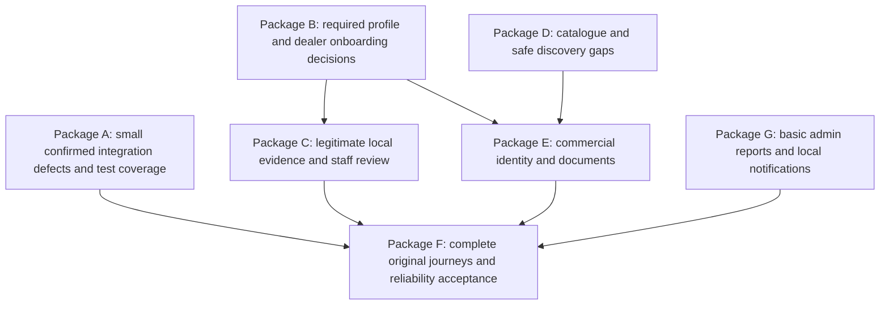

# Recommended development roadmap after the requirements audit

04-11-2026 IST. Proposal only; no feature implementation began. Derived from the 217-row matrix and gap summary. These work packages do not rename earlier completed project Phases 1–8 or authorize a new marketplace/provider/deployment phase.

## Current execution status — Package A only

The later explicit Package A request authorized G01/G02/G04 implementation. Code and automated acceptance now pass: 113 mobile tests, 22 relevant PostgreSQL tests, mobile TypeScript, Django checks/migration consistency, Android Hermes export and signed ARM64 build. See `package-a-implementation-report.md`.

Invoice URL safety/failure handling, explicit IST business dates/FY and four mobile history pagination paths are implemented. **Do not mark Package A fully accepted:** APK installation/launch passed on the phone, but physical owner invoice open/repeat is blocked at unreliable device sign-in, and live page-2 histories are blocked by the current four-record datasets. Original acceptance criteria below remain the gate. No later package has started; no historical invoices or development business records were altered.

## Scope rules and sequencing

Keep Expo React Native/TypeScript, React/Vite, Django REST Framework and PostgreSQL. Continue the existing repository/models/domains and preserve user changes. Use controlled local accounts and `smarttrade_dev`; any future schema change must be reviewed, tested on disposable data and approved/applied only to a confirmed target. Preserve historical issued commercial records, audit events and existing phone files.

Do not add SMS/email/payment/cloud integrations, external tax lookup or service-provider/jobs features to resolve this audit. Continue explicit development-only simulations with production fail-closed boundaries. Do not make production security claims from a local test APK.

Dependencies:

Packages may be split into small tasks. Do not postpone an isolated, approved invoice URL fix until every business-field decision is resolved. Conversely, do not invent consent/tax/evidence rules to avoid a dependency.

## Package A — close confirmed integration defects first

| Feature | Priority and dependencies | Acceptance criteria |
| --- | --- | --- |
| Invoice URL composition | P0; G01/R135, no new model needed | One tested resolver composes the actual API base and backend root-relative download path without repeated prefixes; credentials never go to another origin. Actual existing buyer/dealer owner can download an invoice into app-private storage and open/share it. Anonymous/foreign users remain denied. Repeated download reuses approved local copy; failures do not claim success or leave false metadata. No business records need alteration. |
| India business calendar | P0; G02/R137; depends on approved existing India/IST rule | Keep DB timestamps UTC. Select invoice FY and display invoice dates with explicit Asia/Kolkata. Boundary tests cover 31 March/1 April IST and IST midnight when UTC is previous day; sequence numbering remains supplier/FY-specific. Do not alter/reissue historical immutable invoices automatically. Review correction policy for any affected test records separately. |
| Mobile enquiry/order history navigation | P1; G04/R206–207; existing paginated APIs | Next/previous controls work for Buyer and Dealer enquiry/order histories over more than one page; counts, filters, selection and refresh stay consistent. Out-of-order responses cannot replace current data. Preserve open drafts and authenticated access. API pagination and mobile tests must exercise real page changes, not only page 1. |
| Focused regression gaps | P1; accompanies each fix | Add tests for the actual URL-to-file adapter, calendar-boundary behavior and history pagination. Run mobile/admin checks as affected and PostgreSQL backend tests only in a separately authorized implementation task. Verify on physical phone because emulator reliability is currently poor. |

## Package B — finish approved identity and dealer onboarding

Package B implementation update, 06-11-2026. Personal profile and dealer registered identity, declarations, brand suggestion review, private contacts and duplicate review are implemented and covered by automated checks. Two additive migrations passed on disposable PostgreSQL and are pending on development. Device checks are blocked because ADB detected no phone. A controlled trade-contact reviewer grant, deployment of the local migrations and physical acceptance remain outstanding. The contact minimum is displayed and will be enforced at a dedicated verification submission gate. Package C remains gated by Package B review. See `package-b-implementation-report.md`.

| Feature | Priority and dependencies | Acceptance criteria |
| --- | --- | --- |
| Personal profile | P1; G05/R011/R014–016; required-field/privacy decisions | Existing PERSONAL subtype gains only approved full-name/occupation/Indian location fields through owner-scoped APIs/screens. Account type/mobile uniqueness remain unchanged. No real-phone ownership claim. Invalid PIN/state rejected; cross-account reads/writes denied. Empty/edit/retry states tested. Do not assume GPS is required. |
| Complete Business profile and registered address | P1; G06/R038–042/R052 | Specify authorized-person name, organization email, registered/primary address versus branches and optional identifier applicability. Reuse current BusinessProfile/DealerLocation; do not duplicate dealer accounts. Required/optional decisions reflected consistently in serializer, UI and staff readiness context. Preserve optional GSTIN/PAN and format validation; do not force GST on every business. |
| Dealer category/brand declarations | P1; R043–045/R069; depends on canonical taxonomy | Dealer selects supported categories/multiple sold brands and can view its declarations. These fields do **not** create company authorization or discovery eligibility. Only company grant/revoke changes authorized status. Ownership, revoked grants and product eligibility tests continue passing. |
| Other-brand suggestion/review | P2; R046–047; requires canonical ownership/conflict policy | Private proposal with review state/reason/audit; not a canonical brand on submission. Staff cannot assign another company's ownership without approved evidence/authority. Approved outcome links to a verified owning company, preserving one owner per brand. Reject/duplicate/resubmit behavior explicitly decided and tested. |
| Trade-worker contacts and permission | P1 decision gate, then scoped implementation; R048/R049 | Approve business permission evidence, per-contact name/mobile/trade/optional area, validation/deduplication/minimum-count rules, correction/removal/retention and future individual opt-in. Enforce the agreed minimum at business verification submission, not arbitrary sign-in. Contacts stay private and never become service-provider profiles automatically. Backend/frontend/admin privacy tests required. Do not invent consent wording or start the provider marketplace. |
| Duplicate company/business identity | P2; R053/R081/R098/R113; policy needed | Agree identifier scope and conflict handling; use reviewable candidates rather than global legal-name uniqueness or destructive merge. Same-mobile duplicates remain prevented; distinct legitimate businesses/branches are not blocked incorrectly. Any canonical consolidation preserves ownership and audit and requires explicit authorization. |

## Package C — make local verification evidence honest and usable

**Hard dependency:** explicit decision on T01. Mobile-selected file contents currently stay on their phone and cannot be reviewed from the laptop admin. No implementation may claim staff received them or silently restore uploads to fix the journey.

| Feature | Priority and dependencies | Acceptance criteria |
| --- | --- | --- |
| Company local evidence review contract | P1, decision before code; changed R093/R097/R195 | Choose an explicitly local/consented demonstration or evidence-inspection procedure consistent with file policy, or accept that fresh submission remains blocked. Define exactly what admin has inspected and what event can be recorded. No provider/cloud/automatic transfer, fake document receipt or bypass of company ownership/verification. Required local scenario must be possible and clearly labelled, or documented blocked. |
| Dealer verification application | P1; B fields/contacts and local evidence decision | Separate submitted evidence/checklist/case readiness from a staff state setter. Approve/reject/suspend/restore remain reasoned, authorized and audited; pending/rejected/suspended businesses cannot self-publish. Admin verifies actual available evidence, not merely a name. Existing status/history retained. |
| Company completeness, logo and lifecycle administration | P2; R085/R089/R092/R094/R096/R100/R163 | Decide whether brand is a preverification declaration or postverification canonical entity, which registration fields are applicable/required, logo local-only behavior and public contact policy. Allow staff to find verified/rejected/suspended companies without relying on a pending queue. Company suspension must not independently block the account; account blocking must still revoke tokens. |
| Account administration and restricted recovery | P2; R161 and later architecture obligation T04 | A least-privilege staff directory and reasoned block/restore actions, if approved, cannot expose secrets or grant arbitrary roles. Define a strictly restricted account-review/recovery route independent of marketplace access; company review alone is not a blocked-account recovery mechanism. Old tokens remain revoked after restoration. No provider integration required to design the boundary. |

## Package D — close catalogue/discovery gaps without scope expansion

| Feature | Priority and dependencies | Acceptance criteria |
| --- | --- | --- |
| Canonical model/HSN/tax metadata | P2; G10/R072/R076–077/R170; approved business/tax contract | Decide model-number versus SKU semantics; explicit typed HSN/tax metadata where applicable, with provenance/effective history and optionality. Company owns metadata; staff oversight is permissioned. Never infer GST rates, applicability or HSN. INR-only persists. Integration with quotations/invoices is explicit and versioned. |
| Duplicate product review | P2; G12; matching-scope approval | Review candidates for same brand/code across categories and variant models; distinguish legal reuse from accidental duplicate. No automatic deletion/merge. Validate ownership and preserve listings/commercial snapshots referencing old records. |
| Buyer dealer badges and permitted contact | P2; G07/R031–033 | Separate safe verification/brand-grant labels from private account/contact data. Define consented public contact field and permitted contact action. Unauthorized/withdrawn/suspended/deactivated data stays invisible on every protected request; revocation updates badges/visibility immediately. No private phone/email leak. |
| Local catalogue PDF/logo/image references | Decision-dependent; R078/R092 and changed image/PDF rows | If approved for local use, private selection/open/delete with metadata and accurate local-only labels. No claim buyer/admin can view a file stored only on a company's phone. Shared media distribution remains parked until a separate approved storage change. |
| GPS/distance/nearby | Optional, parked until explicitly prioritized; R029/R035 | Approve coordinates, consent wording, radius, ordering and fallback labels first. Existing PIN/locality/district remains fully usable without GPS. No hardcoded radius or false distance. This is not a prerequisite for current dealer discovery. |

## Package E — complete commercial identity and original document workflows

| Feature | Priority and dependencies | Acceptance criteria |
| --- | --- | --- |
| Freeze quotation identity | P1; T02/R119/R125; minimal snapshot contract approval | At send/revision capture accepted commercial product/variant/brand/supplier identity. Renaming catalogue/profile data afterwards does not change sent/accepted quote display or the resulting OrderItem. Numeric quote revisions and audit remain immutable; rejection/expiry/superseding rules persist. Test a rename between sent→accepted→order creation on disposable fixtures. |
| Dealer-initiated cart/quotation | P1/P2 substantial work; B recipient/profile, D metadata, R058/R061/R116–117 | Existing enquiry response flow remains. Dealer may create an approved customer-bound draft from eligible canonical products and review quantities/items, without granting brand authorization or cloning catalogue rows. Decide cross-brand/branch/cart eligibility, draft persistence and permissions first. Cart is not a purchase/payment/order reservation. |
| Discount/list price/tax/terms/numbering contract | P1 decision gate before commercial renderer; R060/R120–130/R133 | Explicit catalogue list-price snapshot versus selling price, discount base/percent/amount, tax applicability and rounding, recipient/supplier identity, terms version and quotation numbering. No invented legal rules or automatic rates. Invalid totals/foreign currency/unauthorized recipients rejected; accepted documents cannot be silently recalculated. |
| Quotation PDF and registered-customer sharing | P2; previous E tasks; R064/R062 | Complete required identity/item/code/description/price/discount/HSN/tax/terms content, date in IST, wrapping/multipage, no clipped totals. Authenticated authorized customer can receive/read/respond through current app. Define a local PDF generation/retention/download/share path consistent with no-cloud policy. Do not implement guest links, WhatsApp provider or external delivery implicitly. |
| Invoice completeness and rendering | P1 before client use; G03/R140–153; approved data/legal policy | Snapshot approved supplier address and buyer details, brand/code/description/terms and explicit tax/supply basis. Manual payment-status scope is decided separately from collection/gateways. Long/multi-item PDF visual tests prove totals/headers/continuation are readable. Issued records stay immutable and historical data is never rewritten to retrofit fields. Do not certify statutory suitability without required information/review. |
| Invoice order/quote chain | Regression gate, not a new feature | Accepted quote → one order → dealer confirmation → one invoice → owner download/open. Duplicate creation, rejected/expired quote, cancellation, cross-owner access and supplier/FY sequence race tests pass. Admin remains read-only for commercial content. No payments or delivery module. |

## Package G — basic admin/reporting and local notification coverage

| Feature | Priority and dependencies | Acceptance criteria |
| --- | --- | --- |
| Required basic reports | P2; G13/R174–176; metric/privacy definitions | Real role/company/dealer totals, product/category/brand/listing and quotation/invoice date/status reports with verified queries and explicit filters/timezones. Empty/error states and permission tests; exports only if approved. No fabricated metrics. Advanced sales/demand/performance analytics remains deferred. |
| Admin evidence and audit navigation | P2; C workflows | Existing three-source audit hub stays honest about coverage. Provide approved company/business/commercial subject histories and actor/reason links where needed; no unaudited status editing. A combined exhaustive platform log is not claimed without complete source coverage. |
| In-app local notifications | P2/P3 decision-dependent; G14/R178–181/R192 | Define persisted local/backend event records and unread/read acknowledgement for current core events without SMS/email/push providers. Retries do not duplicate notifications; ownership/blocked-state/privacy enforced. Status labels are not misrepresented as delivered alerts. |

## Package F — acceptance and reliability closure

After each small feature, run affected tests and review diffs; do not repeatedly run unaffected suites without a reason. Before original-core acceptance:

1. Verify new Personal profile → catalogue → selected variant → authenticated PIN discovery → approved contact/details path on a real phone.
2. Verify new Company onboarding/evidence path **only if C's local policy is approved**, otherwise retain an explicit blocker. Verified controlled accounts can separately test brand/product/authorization without being proof of onboarding.
3. Verify dealer registration/completeness/contacts/declared brands → legitimate manual verification → branch/grant/listing and original approved dealer quotation journey.
4. Verify registered Buyer enquiry → dealer revision → rejection/acceptance/expiry → order/confirmation/cancellation/status history → invoice download, with cross-role/IDOR/blocked/revoked/suspended tests.
5. Close Stage E on a responsive Android runtime: encrypted session restoration, refresh rejection clearing, outage retention/recovery, durable disposable-file restart/offline behavior, missing/invalid/oversize/access-failure handling. Simulate low-space only with an isolated safe mechanism; never fill or reset the user's device to manufacture a result.
6. Preserve India-only numbers/PIN/states, INR, UTC persistence and IST business/display calendar. Review actual PDFs, not only `%PDF` headers. Include >page-size histories and long/large documents.
7. Run full PostgreSQL tests/migration consistency against disposable test DB through existing controlled test role in the future implementation task; never migrate an unknown database. Run mobile/admin tests and TypeScript plus Android build. Treat iOS as unverified until built/tested with the required Apple toolchain. Record skips/blockers honestly.

## Decisions required before dependent work

- T01: exactly how a local administrator can legitimately inspect company/dealer evidence while selected file contents remain on a separate phone; generated backend PDFs versus strict phone-only wording.
- Required Personal/business/company profile fields, registered-address semantics, applicable license/tax evidence and retention; avoid invented mandatory GST.
- Trade-worker permission confirmation/individual opt-in wording and correction/retention/minimum-count details; no automatic public profiles.
- Public contact consent and scope; canonical duplicate identity resolution, representative delegation and staff/account recovery rules if still required.
- Commercial tax/discount/rounding/numbering/terms snapshots and manual payment-status scope; authoritative legal/tax review before statutory claims.
- Future file limits/backup/retention, load/performance budgets and optional nearby radius remain decisions, not arbitrary constants to implement.

## Parked features

Service-provider/jobs/employer marketplaces, real verification/notification providers, guest quotation links, payment gateways/collection, WhatsApp integration, cloud storage/deployment, ratings, advanced inventory/ERP/GST-portal integrations, delivery, translations, AI and advanced analytics remain outside the proposed immediate work. Do not turn the PDF's future enhancement lists into implicit authorization.

The audit found no reason to replace the architecture or rebuild completed account/catalogue/dealer/order domains. Close concrete defects, decide policy-dependent gaps, then extend the existing contracts with tests and actual local workflow evidence.
